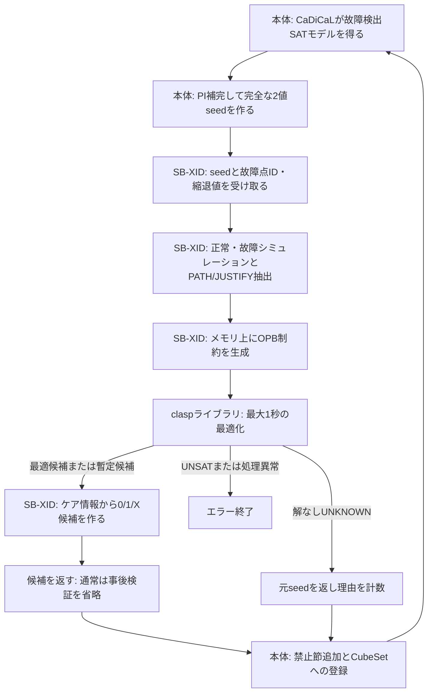

# 現行FDPを基軸にしたSB-XID移植設計

ユーザーの方針を反映した移植設計。コード実装に続き、クラウドへclaspを導入し、C++接続・本体のビルドと本物のclaspでの小回路実験を実施した。実装と導入手順は [SB-XID実装README](../src/fdp/sbxid/README.md)、実験結果は [実ライブラリでの確認記録](sb_xid_real_clasp_checks.json) を参照。末尾12節までには導入前の検討・実装時点の経緯を含む。

最新の検討は10節を参照。ユーザーの指摘を受けて、候補の事後3値検証を「毎回必須」とした説明を訂正した。通常実行では事後検証を省略し、移植確認・デバッグ用に残す方針に合意した。

## 今回の方針

- 現行FDPのネットリスト読込、NLIST、故障管理、CaDiCaL、正常CNFの範囲限定、列挙、BDD、プロセス並列を基軸にする。
- 旧XIDとの共存を前提にせず、旧XIDのソース・ヘッダ・型への依存をビルド経路から外す。
- 同梱SB-XID v1のCEGARなし版を移植する。制約式・目的関数・探索と正当化の規則を保つ。
- SBの専用ネットリストは作らず、現行NLISTにSB用の状態を追加する。
- SB専用状態と関数にはsbxid / SBXIDという名前を付ける。
- PI補完は必要範囲のPIをSAT値、範囲外PIを初回0として全PIの元パターンを用意する。実装時の確認により、禁止節へ入ったPIは以後その故障のSAT値を使う（末尾追記参照）。
- 求解後の候補の事後3値検証は通常実行では省略する。移植確認・デバッグ用に残し、有効時の検証失敗では元の0/1パターンへ戻して計数する。
- 各clasp求解の打ち切り時間は経過時間1秒とする。最適性未証明でも有効な実行可能モデルがあれば候補を採用する。解なしのUNKNOWNは元の2値パターンへ戻して続行する。
- claspのUNSAT、元の2値パターンが検出しない不整合、メモリ確保・OPB解析等の失敗はエラー終了とする。
- SB-XIDの作業状態とclaspは各workerに持たせ、既存の故障プロセス並列を維持する。探索は各worker内で1スレッドとする。
- 本体への移植の正しさは、まず小回路の無制限列挙で完全FDPが一致することを確認し、その後に速度を比較する。
- 既存の故障をlevel順に並べ替える処理は削除する。対象一覧は元のハッシュ表の走査順を使う。workerへの配分・出力順の管理に必要な一覧化は残す。
- 既存52回路ではdanglingによる観測点の不一致がないため、今回の移植で現行TPGの観測条件は変更しない。dangling対応やそのための起動時検査は追加しない。

## 1. 共通のNLISTへ専用3項目を追加する

命名案は以下。flag保存・復元案から、専用フィールド案へ設計を更新する。

```c
/* 現行NLISTの既存項目を維持したうえで追加する案 */
int sbxid_normal_value; /* 正常回路の値：0 / 1 / X */
int sbxid_fault_value;  /* 故障回路の値：0 / 1 / X */
int sbxid_flag;         /* SB-XIDの評価・PATH・JUSTIFY状態 */
```

| SB元コード | 移植後の案 | 意味 |
|---|---|---|
| `node->value` | `node->sbxid_normal_value` | 正常側の実際の論理値 |
| `node->signal` | `node->sbxid_fault_value` | 故障側の実際の論理値 |
| `node->flag` | `node->sbxid_flag` | SBの作業ビット |
| `FLAG_EVALUATED` | `SBXID_FLAG_EVALUATED` | 評価済み |
| `FLAG_PATH` | `SBXID_FLAG_PATH` | 故障伝搬領域 |
| `FLAG_JUSTIFY` | `SBXID_FLAG_JUSTIFY` | 正当化領域 |
| `XVAL` | `SBXID_X` | X=2 |

既存の `flag` / `logic_value` / `ea_flag` / `unique_flag` / SAT変数番号はそのままの役割で残す。SBの初期化・リセットはsbxid_*項目だけを操作する。SBのビットは専用フィールドに置くため、1/2/4の値を保ってよい。

```c
/* 元コードのフラグ消去に対応する案 */
for (int i = 0; i < n_net; ++i)
    nl[i].sbxid_flag = 0;
```

専用フィールドなので、本体flagを保存・復元する配列や処理は不要。全コンパイル単位で現行のnetlist.hを使うため、古いSB構造体とのキャストもしない。

3項目の参照先変更は機械的なリネームとして管理する。制約式や分岐条件を別手法へ変更する作業とは分け、移植元との比較ができるようにする。マクロで `value` 等を一括置換して見えなくする方法は使わない。

`FAULT_CTX.signal` はノードの単一値とは異なる故障値配列である。これも見直す場合は `SbxidFaultContext.fault_values` のように用途を区別する。全てのループ変数やローカル変数へ接頭辞を付ける必要はない。

`varV/varS` は実際の論理値でなく、ケアを表すPBO変数番号である。移植時に保持する場合も宣言コメントで区別し、実際の0/1/X値と混同しない。

## 2. 現行回路を直接使う

SBのNetlist.cとNetlist.hは本体へ取り込まない。現行の `nl[]`、`pi[]`、`po[]` と接続を直接使う。読み直し、グラフの複製、別NLISTへのポインタ変換は行わない。

SB本体の移植先は例えば `src/fdp/sbxid/`。本体との受け渡しと元のSB処理を置き、claspのC++接続を別ファイルにする。C++側へNLISTのグローバル定義を持ち込まず、OPBと結果を扱う小さなC境界にする。

旧XIDのenqueue/dequeueを残すための共存設計は不要。新しいSB関数には `sbxid_` 接頭辞を付け、本体の関数との所有関係を明確にする。`nl` や `pi` は本体の回路なので、別のsbxid_nl等を作る必要はない。

SB元コードから残すものは、3値シミュレーション、PATH/JUSTIFY抽出、バッチ版K=1の制約生成、ケア入力抽出、候補検証。main、回路の再読込、Windowsのプロセス起動・固定一時ファイル等は本体の呼出経路に持ち込まない。

## 3. PI補完とシミュレーションの役割

現在の補完方法を維持する。

```c
for (int p = 0; p < n_pi; ++p) {
    int bit = NormalScopeRequiredNet(pi[p]->n)
        ? ccadical_val(solver, (int)pi[p]->varsgc) > 0
        : 0;
    seed[p] = bit ? '1' : '0';
}
seed[n_pi] = '\0';
```

この補完によって、PI順と入力本数を変えずに全PIの完全パターンを作る。内部ゲートの値を未投入SAT変数から取得しない。補完後の正常／故障値はSBの元の論理シミュレーションで求める。

通常実行で旧XID向けの全回路復元とSBのシミュレーションを二重に走らせる必要はない。PI抽出は本体の関数として切り出し、以後はSBへ渡す。

`FDP_NORMAL_SCOPE_VALIDATE` を残す場合は、SBが完全な元パターンをシミュレーションした直後に、保持範囲のSAT値と `sbxid_normal_value` を照合する。候補キューブ検証後はXが含まれるので、その段階でSATの元モデルと比較しない。

## 4. 旧XIDを外す際の依存

単にInlineXIDの呼出しを変えるだけでは、現在のnormal_scope.hに以下が残る。

```c
#include "xid/XID.h"
void NormalScopeModelValues(CCaDiCaL *solver, XID_VAR_INFO *values);
```

この型依存を外し、例えば `NormalScopeFillPiPattern(solver, seed)` のようなPI補完APIへ置き換える。normal_scope_values.cはPI補完へ役割を変更するか、補完処理をnormal_scope.cへ移して旧ファイルを外す。旧シミュレーションの作業領域をなくす場合、NormalScopeModelReleaseの呼出しも整理する。

| 箇所 | 設計上の変更 |
|---|---|
| CMakeの旧 `src/fdp/xid/*.c` とincludeパス | ビルド対象から外す |
| `fault_detection_prob.c` | 旧XIDヘッダ・呼出しを外し、PI補完→SBへ変更 |
| `normal_scope.h` | XID_VAR_INFOと旧XIDヘッダへの依存を除去 |
| `normal_scope_values.c` / Release呼出し | PI補完と検証の役割に整理 |
| `FaultStats.xid`、`time_xid`等 | sbxidと分かる名前へ変更 |
| ログの方式名 | SB-XID、clasp版、検証・フォールバック件数を記録 |
| SBのヘッダ | 本体の共通NLIST定義を参照 |

ユーザー回答により、InitTargetOrderの既存のlevel順への並べ替えは削除する。CompareTargetとqsortに相当する整列を外し、対象一覧は元のハッシュ表の走査順を使う。worker配分・出力管理・SetTargetに必要な対象一覧の作成まで削除する意味ではない。`level` はEAのキュー整列でも使われるため残し、旧XIDや故障整列の除去を理由にEAまで削除しない。

## 5. 作業状態の寿命

各パターンについて以下を区別する。

1. 元の0/1パターンを独立した文字列seedとして保持する。
2. SBのケース開始時に作業値を初期化し、PIへseedの値を設定する。
3. 正常／故障シミュレーションを行い、元パターンが実際にPOを検出することを確認する。
4. SBの元の処理でPATH/JUSTIFYを抽出し、PBOを求解する。
5. 実行可能モデルから候補キューブを取り出す。通常実行では事後検証を省略する。移植確認・デバッグで事後検証を有効にした場合のみ検証し、不一致ではseedへ戻して計数する。
6. 成功候補またはseedを全PI順の0/1/Xで返し、本体が禁止節とCubeSetへ渡す。

ケース開始時の値初期化と、元コードのclear_all_flags相当は別の処理。シミュレーション後のフラグ消去で正常／故障値まで消すとPATH抽出ができないため、フラグだけを消去する規則を保つ。

SBの候補検証は作業値をX混じりの値へ上書きする。フォールバックは保持したseedを使い、上書き後のPI値から再構成しない。

## 6. danglingの調査例（今回の移植では対応しない）

danglingは、ここでは「ゲートの出力として存在するが、外部出力にも他ゲートの入力にも接続していない内部信号」を指す。wire宣言だけが余っている場合とは区別する。

```verilog
module dangling_example(a,b,y);
input a,b;
output y;
wire d;
AND2 u_unused(.A(a),.B(b),.Z(d));
OR2  u_out   (.A(a),.B(b),.Z(y));
endmodule
```

式は `d=a AND b`、`y=a OR b`。外部から観測できるのはyだけで、dはyへつながらない。

dに縮退0故障を入れ、a=b=1を与えた場合：

| 信号 | 正常 | 故障あり | 外部で観測可能か |
|---|---:|---:|---|
| d | 1 | 0 | できない |
| y | 1 | 1 | 観測できるが値が変わらない |

dは故障励起しているが、故障を外部出力で検出できない。全4入力を確認してもyは変わらないため、外部出力で定義した正しいFDPは0である。

ところが現行SearchTFOは、n_out=0の全ノードをTPOとして設定し、検出CNFはそのTPO上の正常／故障差を条件にする。dにもn_out=0なので、dの差を検出と数える。旧XIDを外しても、このTPGの条件は残る。

現行ソースを変更せず、別ディレクトリでDebugビルドし、対象 `d sa0`、無制限、jobs=1、支配流用offで実行した結果：

```csv
net_name,f_type,cube_cnt,complete,fdp,seeded_cnt
d,sa0,1,1,2.5000000000e-01,0
```

a=b=1の1入力を数えて1/4になっている。一方、SBのPO検証はpo[]にあるyだけを見るので、この元パターンを検出パターンとして扱えない。これは型・命名の移植問題とは別の、観測点のモデルの不一致である。

回路例・CSV・独立の全入力表は `sb_xid_netlist_audit/` へ保存した。既存52回路ではnout=0の集合とpo[]の集合が一致していることを前回確認済みで、この例の不一致は見つかっていない。

## 7. 元パターンの不一致と候補の検証失敗

| 状態 | 扱い |
|---|---|
| 元パターンはPOを検出し、SB候補も検出する | 候補を採用 |
| 元パターンはPOを検出するが、SB候補は検出しない | 合意どおり元パターンへ戻して計数 |
| 元パターン自体がPOを検出しない | 元パターンへ戻しても健全にならない。モデル不一致として扱う |

danglingの例は3行目。フォールバックで覆い隠さない。

ユーザーの回答により、今回は既存回路を前提として現行TPGの観測条件を維持する。上の例は既存回路から見つかった問題ではなく、前提差を確認するために作った調査例である。観測条件の修正やdangling専用の起動時検査は移植範囲へ含めない。

元パターンの不整合と候補の検証失敗を区別すること自体は、dangling対応とは別に必要である。

## 8. 実装前に確認する条件

- 専用3項目へのリネーム後も、初期化・シミュレーション・PATH/JUSTIFY・制約生成で読む値が移植元と対応している。
- 本体のflag、EA、SAT番号、接続、PI/PO順序をSBが変更しない。
- 旧XIDヘッダ・型・ソースが本体ビルドの依存に残らない。
- PI補完、SBの完全パターンの値、保持範囲内のSAT値が一致する。
- PBOの制約式・目的値・ケア数と候補の健全性を確認する。同点解のビット位置の一致だけは要求しない。
- 候補失敗時のフォールバックと、元パターンの不整合を別に確認する。
- 現行ベンチマークの完全FDP、支配流用、プロセス並列、CSV順序を照合する。

claspのC++ライブラリ接続、同梱v1のCEGARなし、メモリOPB経由、K=1のバッチ処理という前の方針は維持する。

## 9. 追加検討と回答の反映

### 9.1 claspの終了状態と、最適化をどこまで待つか

元のrun_clasp_and_parseは最適解と最適性未証明の実行可能解を区別し、run_single_shot_multiは両方を受け付ける。ライブラリ接続でも最初のモデルと最適化終了を混同しない。

同梱saxid.c:1090の起動引数には時間上限がなく、system()の終了まで待つ。clock()は計測用で、打ち切り処理ではない。

ユーザー指定により、各clasp求解の打ち切り時間を1秒にする。経過時間で測り、SB側の回路シミュレーション・OPB生成・候補検証の時間とは分ける。キューブ数の-limitは列挙上限であり、この時間制限とは異なる。

打ち切りまでに最適性未証明でも有効な実行可能モデルが得られていた場合は候補を採用する。10節の検討を経て、通常実行での事後3値検証は省略する方針に更新した。候補がないUNKNOWNはseedへ戻す。最適解/暫定解/UNKNOWNと、時間切れの有無を別々に記録する。

ライブラリ接続の具体案は、公式のSolveMode_t::Async、SolveHandle::waitFor(1.0)、cancel()を利用すること。打ち切りは求解器の協調的な停止であり、停止完了を待ってから次のケースへ進む。改善モデルのコールバックで最新候補を独立領域へ保存し、停止完了後に取り出す。候補の探索途中の状態は返さない。

この案ではCLASP_BUILD_WITH_THREADS=ONが必要。探索自体はparallel_mode=1で、複数の探索スレッドは使わない。非同期求解用スレッドと待機する呼出元は、複数探索スレッドによる並列化とは区別する。実装時に最適/暫定候補ありの時間切れ/候補なしの時間切れ、および次ケースへのタイマー持越しがないことを確認する。

### 9.2 候補失敗と処理異常を分ける

以下の扱いに合意した。

| 状態 | 扱い |
|---|---|
| 有効な最適モデルまたは暫定モデルを得る | 候補採用。通常実行では事後検証を省略 |
| デバッグで有効にした事後検証で不一致を見つける | seedへ戻して検証失敗を計数 |
| 解がないUNKNOWN | seedへ戻してUNKNOWNを計数 |
| claspがUNSAT | エラー終了 |
| 元seed自体が検出しない | 不整合としてエラー終了 |
| OPB生成・解析、メモリ確保等の処理失敗 | エラー終了 |

claspのUNSATはCaDiCaLの検出モデルUNSATと別なので、冗長故障/FDP=0と解釈しない。エラー時はその結果で禁止節を追加したり、正常完了のFDP行を出したりしない。

元verify_pattern_detects_faultはメモリ確保失敗も0で返す。移植時には、この失敗を「候補が非検出」と混同しないよう小さな状態通知の変更が必要になる。

### 9.3 検証の強さと実行する場所

元のrun_single_shot_multiはg_write_resultまたはdebug_printfがある場合だけ検証する。移植後は通常実行では事後検証を省略し、移植確認・デバッグ用の設定で有効にする。

元の3値検証は、いずれかのPOで正常・故障値がともに0/1で、互いに異なることを要求する。この条件が成立すれば全具体化に対する検出を保証できるが、Xの相関を失うので、成立しないキューブが必ず不正とは限らない。

当初は毎回の検証を提案したが、10節の検討によりその位置付けを訂正した。以下の例は一般の3値シミュレーションの限界の説明である。SB-XIDの制約を満たす候補がその例で事後検証に失敗するという意味ではない。

補足：キューブ1Xは、完全パターン10と11の両方を表す。一方だけが検出できても、このキューブは採用できない。例えばy=a OR bのy sa0では、1Xは正常y=1/故障y=0となり採用できる。0Xは正常y=X/故障y=0となり、00では実際に非検出なので採用できない。

ただし、3値で確定できないことだけでは、そのキューブが不正だとは断定できない。例としてn=NOT b、t=b OR n、y=a AND t、故障y sa0を考える。

| 1Xの具体化 | n | t | 正常y | 故障y | 検出 |
|---|---:|---:|---:|---:|---|
| a=1,b=0 | 1 | 1 | 1 | 0 | する |
| a=1,b=1 | 0 | 1 | 1 | 0 | する |

実際のtは常に1だが、3値計算ではb=X、NOT b=X、X OR X=Xとなり、正常yもXになる。bとNOT bが必ず逆になる関係をXという記号が保持しないためである。ただし、このSB-XIDの制約はbの固定を要求するため、そもそも候補1Xを許さない。詳しくは10.2節を参照。例の具体化2通りは独立した簡単な論理計算でも確認した。

### 9.4 本体とSBのAPI・所有権

推奨案は、本体側がCaDiCaLからseedを作り、SB側はseed・故障点ID・縮退値0/1を受け取ること。SB側へCaDiCaLのsolverやFNODE全体を渡す必要はない。

結果は全PI順・長さn_piの0/1/Xへ統一し、採用/seedへの復帰/処理異常を明示する。出力領域は本体が確保してSBに渡す案とし、採用後は既存CubeSetへ所有権を渡す。SBの一時領域と出力文字列の寿命を分ける。禁止節は採用または復帰が確定した後にのみ追加する。

1つのworker内の流れは以下。回路の接続は本体のnl/pi/poを直接参照し、作り直さない。SBのノード作業値はsbxid_normal_value/sbxid_fault_value/sbxid_flagへ書き込む。



claspが返すのは元の0/1信号値ではなく、どのPIをケアとして残すか等のPBOモデルである。例えばseed=1011、ケア情報=1010なら候補=1X1Xになる。ケア位置の値は元seedから保持する。

### 9.5 状態の再利用と並列性

初期版では各キューブのPBOを独立に作成・求解・解放し、前ケースのモデル/探索状態を引き継ぐ最適化はしない案。PATH/JUSTIFYはseed依存なので、同じ故障でも固定キャッシュにしない。回路の名前検索等の既存索引は回路の寿命に合わせて扱う。

既存の故障プロセス並列を維持し、各workerが自分のSB作業状態とclasp求解を持つことは合意済み。fork後のプロセスごとの回路作業状態であり、worker間で同じ値を共有書込みしない。claspの探索は各workerで1スレッドとし、故障並列とclasp内部の探索並列を二重化しない。パターンごとに前の求解状態を引き継がない方針も維持する。

### 9.6 移植の合格条件と性能評価

ユーザー指定により、まず小回路の無制限実行で、各故障について既存の完全FDPと一致することを移植の合格条件とする。無制限とは列挙キューブ数に上限を設けないという意味で、各claspの1秒制限は維持する。その後に速度等を比較する。

元SBとの同一seed・故障での制約等の照合は、差分を調べる補助として使える。同点最適解ではキューブ位置が変わりうるため、文字列の完全一致は要求しない。また、1秒で得られた暫定候補について元SBの時間無制限の最適値との一致は要求しない。

上限付きでは同じキューブ数でも覆う入力集合が変わるため、旧XIDと部分FDPが一致することは要求しない。性能評価では総経過時間、最適化時間、キューブ数、時間切れ・UNKNOWN・フォールバック件数を記録する。CSVの既存列を維持し、SBの診断・内訳はログへ出す案。

## 10. 候補の事後3値検証の位置付けの訂正

ユーザーから「SB-XIDの制約で検出が保証されているなら、事後3値故障シミュレーションは不要ではないか」と指摘があった。対象の組合せ回路・対応ゲートで、制約生成とモデル取り出しが正しく動く前提では、その通りである。これまでの「毎回必須」という説明を訂正する。

### 10.1 元コードの制約が保証すること

- saxid.c:523–541ではPATHの入力側の非PATH信号をJUSTIFYへ入れ、さらにその入力側を遡る。対象領域は入力側へ閉じており、ゲート入力の正当化が制約に含まれる。
- saxid.c:616–672のゲート正当化は、出力をケアにすると、その元の値を維持するのに十分な入力をケアにする制約を作る。AND/NAND/OR/NORでは制御値の場合に対応する入力を少なくとも1つ、非制御値の場合には全入力を必要とする。INV/BUF/FOUTは元入力、XOR/XNORは全入力を必要とする。
- ケアPIは元の2値seedを保持するので、これらの含意を入力側から辿ると、ケア内部信号も元の正常値/故障値を維持する。故障起点の故障側は縮退値に固定されるため入力由来の正当化を省く。
- saxid.c:969–982は元の正常値と故障値が異なるPATH上のPOについて、少なくとも1つのPOで両側をケアにする。したがって、そのPOの確定差が維持される。

このため、正しい実行可能PBOモデルから抽出したキューブは、対象故障を検出する十分条件を満たす。最適性証明はXの多さについての条件であり、実行可能キューブの検出保証には必要ない。1秒打ち切り時の最適性未証明モデルにも同じ議論が適用できる。

これはコードの制約から整理した健全性の論拠であり、移植実装を既に検証したという意味ではない。

### 10.2 前の相関の例の訂正

9.3節のb OR NOT bの例は、一般の3値シミュレーションの限界を示す。しかし、提示した1Xという候補がこのSB-XIDのPBOを満たすことは示していなかった。事後検証でSB候補が落ちる例として扱うのは不適切だった。

実際には、a=1,b=0のseedでy=1をケアにすると、ANDの制約からt=1もケアになる。t=b OR NOT bでは元に1だったNOT bをケアにする必要があり、そのINVの制約からbもケアになる。b=1のseedでもtの正当化はbをケアにする。従って1Xはこの制約では許されず、生成段階で除かれる。相関を利用できない保守性は、ここでは生成側の制限として現れる。

### 10.3 更新する構成案

通常実行では、claspの有効な最適/暫定モデルから得たキューブを事後3値検証なしで本体へ返す。事後検証コードは移植確認・デバッグ用に残す方針に合意した。UNKNOWNでseedへ戻す、UNSATや処理異常でエラーとする方針は維持する。事後検証を有効にした確認実行で不一致が見つかった場合には、従来合意のseedへの復帰と件数記録を利用できる。

求解前の正常/故障シミュレーションは、元の信号値・PATH/JUSTIFY・制約生成に使うので残す。省略を検討しているのは求解後の候補に対する追加のシミュレーションである。小回路の無制限列挙で完全FDPが一致することを最初の受入れ条件とする方針も維持する。

## 11. 実装前に残る確認と、実装時に検証すること

以前の「故障の処理準備は不要」は、既存のInitTargetOrderによるlevel順整列の削除という回答を得た。故障一覧の走査順を使い、EAに必要なlevelは残す。これで実装前の主要な仕様の未決事項は解消した。

以下は新しい方式を選ぶ相談ではなく、合意した設計を実装した際の検証事項とする。

- 1秒打ち切りで有効な直近モデルが保持されること。候補なしUNKNOWNはseedへ戻ること。中断した求解が終了し、次ケースへタイマー・割込・モデルを持ち越さないこと。
- fork後に各workerのSB状態・clasp求解を初期化し、worker間で混在しないこと。SB由来の固定一時ファイルを使わないこと。
- 改変前ソースからの比較結果を保存し、c17aとs27_C等の小回路で無制限列挙の各故障の完全FDPを比較すること。比較するのは故障の集合、完了状態、FDPであり、方式で変わるキューブ数やCPU時間までCSVのバイト一致を求めない。
- 通常のFDP CSVの列を維持し、最適/暫定モデル、時間切れ、UNKNOWNからの復帰、デバッグ検証失敗等の集計をログに出せること。

制約式や正当化規則に機械的な移植以上の変更が必要になった場合は、その具体的な根拠と差分を示して再検討する。

## 12. コード実装時の追記

ユーザーの指示で、claspの新規clone・導入より先にコードを実装した。SBコアのK=1の制約式・目的関数を維持し、現行NLISTの専用3項目、C++ライブラリ境界、1秒の求解打ち切り、暫定モデル保存、UNKNOWN復帰、任意の事後検証を実装した。旧XIDのビルド依存と故障のlevel順整列は外した。旧XIDのファイル自体は参照用に残る。

UNKNOWN復帰で全PIを固定したseedを禁止すると、正常CNFの範囲外PIもその禁止節により制約を受ける。以後も常に0で補完すると同じ禁止済みseedを返す場合がある。そこで正常ゲートの範囲を維持したまま、禁止節へ入ったPIだけSAT値を使うようにした。SBの制約式は変えていない。正常CNFから完全に省かれ、まだ禁止節に入っていないPIの初回0補完も維持する。

clasp不要の4つのCTestと全21 C翻訳単位の構文確認が通過した。本体を常にUNKNOWNを返すテスト用代替実装へリンクした確認では、c17a/s27_Cのjobs=1/2で故障ごとのFDP・完了状態が改変前と一致した。これは本物のclaspでSB-XID一般化を実験した結果ではない。実ライブラリでのコンパイル・1秒中断・暫定モデル保持・完全FDP比較は導入後に確認する。

## 13. クラウドへ実ライブラリを導入した結果

ユーザーの依頼を受け、external/claspへv3.3.9を依存サブモジュール込みでcloneし、build/clasp-installへスレッド対応の静的ライブラリを導入した。本体Debug/ReleaseとC++接続はそのままビルドでき、5つのCTestも通過した。

本物のclaspを使い、c17a（36行）とs27_C（52行）で各故障の完全FDPが旧版と一致した。各回路につきDebug直列、Release直列、Releaseの2worker、支配流用あり、任意の事後検証ありを確認し、全10条件で正常終了した。事後検証ありの157求解では不一致0件だった。

別のPBOでは、約1秒での打ち切りについてモデルなしUNKNOWNと、暫定モデルありFEASIBLEの両方を確認した。後者は保存したモデルが全制約を満たした。元SBの制約式や本体の処理を修正する必要はなかった。結果はsb_xid_real_clasp_checks.jsonへ保存した。
